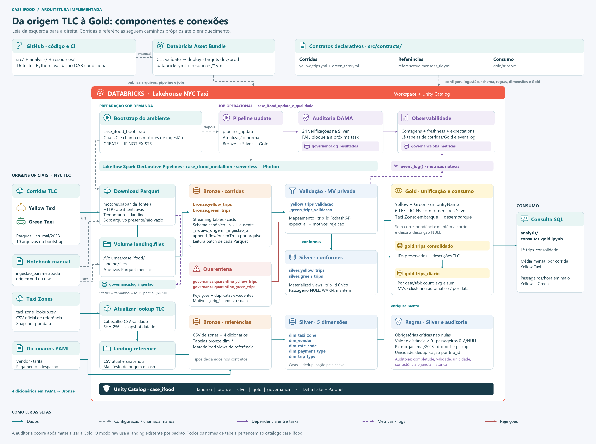

# Case iFood — Lakehouse NYC Taxi

Pipeline Databricks para corridas **Yellow e Green Taxi**, orientado a contratos YAML e organizado nas camadas **Bronze → Silver → Gold**. Inclui dimensões TLC, quarentena, auditoria de qualidade DAMA-DMBOK e consultas SQL. O recorte do case é janeiro a maio de 2023.

[Visão geral](#1-arquitetura-visão-geral) · [Configuração e execução](#2-configuração-e-execução) · [Arquitetura detalhada](#3-arquitetura-detalhada) · [Testes e qualidade](#4-testes-e-qualidade) · [Operação](#5-operação)

## 1. Arquitetura: visão geral


[PNG](docs/arquitetura/arquitetura-visao-geral.png) · [SVG editável](docs/arquitetura/arquitetura-visao-geral.svg)

O **Databricks Asset Bundle (DAB)** valida e publica os arquivos, a pipeline e os jobs no workspace. O job de **bootstrap** cria os objetos de Unity Catalog e baixa as fontes oficiais da TLC para a landing. A pipeline transforma as origens em Bronze, Silver e Gold; o notebook SQL consome as tabelas Gold.

| Recurso | Quando usar | O que faz |
| --- | --- | --- |
| `case_ifood_bootstrap` | Preparação inicial ou reposição dos arquivos | Cria catálogo, schemas, volumes e tabelas de governança; baixa os Parquets Yellow/Green e o lookup de Taxi Zones. |
| `case_ifood_medallion` | Processamento dos arquivos disponíveis | Gera Bronze, Silver, dimensões e Gold a partir dos contratos. |
| `case_ifood_update_e_qualidade` | Execução operacional | Executa `pipeline_update → qualidade_contratos → observabilidade_contratos`. |
| `analysis/consultas_gold.ipynb` | Consumo | Executa as consultas SQL do case; não é uma task dos jobs. |

O job operacional atualiza a pipeline primeiro. A auditoria avalia a Silver depois desse update; portanto, um FAIL interrompe as tasks seguintes, embora a Gold já tenha sido materializada. As cinco dimensões de referência alimentam seis `LEFT JOINs` na Gold, porque Taxi Zone é usada para embarque e desembarque.

## 2. Configuração e execução

### Pré-requisitos

- Git e [Databricks CLI com suporte a bundles](https://docs.databricks.com/aws/en/dev-tools/cli/install).
- Workspace Databricks com Unity Catalog, metastore associado e serverless habilitado para a pipeline e para jobs.
- Permissões para usar/criar catálogo, schemas, volumes e tabelas, publicar/executar jobs e pipeline, e consultar o event log.
- Acesso HTTPS a `d37ci6vzurychx.cloudfront.net`, origem dos Parquets TLC e do CSV de Taxi Zones.
- Python 3.12 é necessário para reproduzir o CI localmente; as dependências dos jobs Databricks estão declaradas nos resources.

O bootstrap prepara objetos do Unity Catalog dentro de um workspace existente. Ele não cria o workspace, o metastore ou o armazenamento de nuvem.

### 2.1. Clonar e autenticar

Os exemplos usam PowerShell:

```powershell
git clone https://github.com/alexvalsechi/case-ifood.git
cd case-ifood

databricks --version
databricks auth login --host https://<seu-workspace> --profile IFOOD_DEV
```

Conclua o login no navegador. No bloco existente `targets.dev` de [`databricks.yml`](databricks.yml), configure o host e o perfil sem remover as demais opções do target:

```yaml
workspace:
  host: https://<seu-workspace>
  profile: IFOOD_DEV
```

A [autenticação de bundles](https://docs.databricks.com/aws/en/dev-tools/bundles/authentication) descreve os perfis aceitos pela CLI.

### 2.2. Validar e publicar o DAB

Na raiz do repositório:

```powershell
databricks bundle validate -t dev
databricks bundle deploy -t dev
databricks bundle summary -t dev
```

Os caminhos da biblioteca da pipeline e dos notebooks estão relativos aos YAML que os declaram. Os notebooks descobrem o diretório `src/` pelo caminho em que estão executando e localizam seus módulos e contratos dentro dele. A pipeline recebe `${workspace.file_path}/src/contracts` pela configuração do DAB. As tasks de notebook têm ambientes serverless e dependências declarados nos jobs; a pipeline usa serverless e declara `PyYAML` no ambiente do resource.

A configuração e os exemplos de caminhos estão na [documentação do DAB](https://docs.databricks.com/aws/en/dev-tools/bundles/settings) e nos [exemplos oficiais de bundles](https://docs.databricks.com/aws/en/dev-tools/bundles/examples).

### 2.3. Preparar catálogo e fontes

O job de bootstrap tem os parâmetros padrão do case: catálogo `case_ifood`, ano `2023` e meses `01,02,03,04,05`.

```powershell
databricks bundle run -t dev case_ifood_bootstrap
```

O job cria os schemas `landing`, `bronze`, `silver`, `gold` e `governanca`; os volumes `landing.files` e `landing.reference`; e as tabelas de governança. Em seguida, baixa os cinco Parquets mensais de cada frota e o lookup oficial de Taxi Zones. O CSV passa por uma checagem de cabeçalho e é gravado com snapshot datado e manifesto SHA-256.

O download dos Parquets é repetível: um arquivo já existente e não vazio é ignorado. Confira a saída e o `case_ifood.governanca.log_ingestao`; a checagem final do bootstrap avisa se faltarem meses. Os parâmetros e o job estão em [`bootstrap_ambiente.ipynb`](src/01_ingestao/bootstrap_ambiente.ipynb) e [`case_ifood_bootstrap.job.yml`](resources/case_ifood_bootstrap.job.yml).

### 2.4. Validar e executar o processamento

Valide o grafo da pipeline e execute o job operacional:

```powershell
databricks bundle run -t dev --validate-only case_ifood_medallion
databricks bundle run -t dev case_ifood_update_e_qualidade
```

A sequência operacional é:

```text
pipeline_update → qualidade_contratos → observabilidade_contratos
     Bronze/Silver/Gold        auditoria da Silver          métricas e event log
```

Se a auditoria gravar uma regra como `FAIL`, ela lança uma exceção e o job não inicia a task de observabilidade. A Gold já foi publicada no update da pipeline. A observabilidade registra métricas e sinaliza atenção; não define um limiar de negócio que bloqueie o job. Os jobs não têm agendamento declarado.

### 2.5. Conferir e consultar os resultados

No SQL Editor ou em um notebook com acesso ao catálogo:

```sql
SELECT taxi_type, COUNT(*) AS qtd_corridas
FROM case_ifood.gold.trips_consolidado
GROUP BY taxi_type;

SELECT *
FROM case_ifood.gold.trips_diario
ORDER BY data_corrida, taxi_type
LIMIT 10;

SELECT *
FROM case_ifood.governanca.dq_resultados
ORDER BY avaliado_em DESC
LIMIT 24;
```

Para conferir as métricas de observabilidade, consulte `case_ifood.governanca.obs_metricas`. Como reconciliação adicional, compare a contagem de linhas de `gold.trips_consolidado` com a soma de `qtd_corridas` em `gold.trips_diario`; essa conferência ainda é manual.

O notebook [`consultas_gold.ipynb`](analysis/consultas_gold.ipynb) responde às duas perguntas do case: média do valor `total_amount` por corrida e mês para Yellow Taxi; média de passageiros por hora do dia em maio para toda a frota.

## 3. Arquitetura detalhada

A imagem mostra os componentes implementados e suas conexões. Leia as origens à esquerda, o processamento no centro e a consulta SQL à direita. A faixa superior identifica a publicação pelo DAB e a sequência dos jobs; corridas e referências têm caminhos separados até a Gold.



[PNG](docs/arquitetura/arquitetura-detalhada.png) · [SVG editável](docs/arquitetura/arquitetura-detalhada.svg) · [Gerador dos diagramas](docs/arquitetura/gerar_arquiteturas.py)

As setas identificam dados, configuração/chamadas manuais, dependências entre tasks, métricas/logs e rejeições. Os nomes de tabelas na imagem omitem apenas o catálogo `case_ifood`. O notebook de consumo lê `gold.trips_consolidado`; `gold.trips_diario` é uma saída adicional. Os nomes de objetos e os hashes das fontes são incorporados ao PNG e ao SVG a partir dos contratos e resources versionados.

| Etapa | Finalidade | Validações e comportamento |
| --- | --- | --- |
| **CI e DAB** | Versionar código, contratos e recursos; publicar a configuração do workspace. | GitHub Actions roda os testes Python; validação DAB é condicional aos secrets. Deploy e execução Databricks são manuais. |
| **Contratos YAML** | Declarar fontes, schemas, regras de qualidade, dimensões e modelos de consumo. | Pipeline verifica membros, referências de dimensões e funções de agregação da Gold. Testes estruturais conferem a configuração e os caminhos. |
| **Bootstrap e landing** | Criar objetos de UC e baixar as origens TLC para os volumes de landing. | `CREATE ... IF NOT EXISTS`; download com tentativas e log. Arquivo existente/não vazio é pulado. O CSV de zonas tem cabeçalho validado e manifesto SHA-256. |
| **Bronze** | Preservar os dados de origem e normalizar variações dos Parquets mensais. | Casts para schema canônico, nomes normalizados, NULL para coluna ausente e inclusão de `_arquivo_origem` e `_ingestao_ts`. Um fluxo batch `append_flow(once=True)` é criado por arquivo encontrado. |
| **Silver e quarentena** | Padronizar colunas e manter uma linha conforme por `trip_id`. | Expectations registram métricas. Regras verificam campos obrigatórios, valor/distância não negativos, passageiros nulos ou entre 0 e 8, janela de datas e `dropoff_datetime >= pickup_datetime`. Inválidos e duplicatas excedentes ficam em quarentena com motivo e origem. Passageiro nulo é WARN e permanece na Silver. |
| **Dimensões TLC** | Traduzir códigos de fornecedor, tarifa, pagamento, despacho e zonas. | Cinco dimensões passam por Bronze/Silver, cast e deduplicação por chave. Quatro dicionários estão em YAML; Taxi Zones vem do CSV oficial. |
| **Gold** | Unificar Yellow/Green, enriquecer as corridas e gerar agregado diário. | `unionByName` aceita colunas ausentes. Seis `LEFT JOINs` preservam a corrida mesmo sem correspondência; a descrição correspondente fica NULL. `trips_diario` agrega por data e tipo de táxi. |
| **Auditoria DAMA** | Avaliar qualidade da Silver após o update do pipeline. | 12 regras por dataset, 24 no total. Grava PASS/FAIL, métrica, horário e até cinco exemplos por falha em `governanca.dq_resultados`; qualquer FAIL encerra a task após o registro. |
| **Observabilidade** | Registrar contagem, freshness e resultados de expectations. | Lê contratos e event log; grava em `governanca.obs_metricas`. Métricas podem sinalizar atenção; falhas técnicas de execução também podem interromper a task. |
| **Consumo SQL** | Responder às perguntas do case e apoiar análises. | Notebook SQL consulta a Gold consolidada e enriquecida. |

### Tabelas de consumo e dimensões

| Tabela | Conteúdo |
| --- | --- |
| `case_ifood.gold.trips_consolidado` | Corridas Yellow e Green com IDs TLC, `taxi_type` e descrições das dimensões. |
| `case_ifood.gold.trips_diario` | Contagem, médias de valor/passageiros e distância somada por data e táxi. |
| `case_ifood.silver.dim_vendor` | Nome do fornecedor do taxímetro. |
| `case_ifood.silver.dim_rate_code` | Nome do código de tarifa. |
| `case_ifood.silver.dim_payment_type` | Descrição da forma de pagamento. |
| `case_ifood.silver.dim_trip_type` | Descrição do tipo de despacho Green. |
| `case_ifood.silver.dim_taxi_zone` | Bairro, zona e zona de serviço para embarque e desembarque. |

A declaração de enriquecimento e do agregado diário fica em [`src/contracts/gold/trips.yml`](src/contracts/gold/trips.yml). As regras e os schemas de ingestão estão em [`src/contracts/yellow_trips.yml`](src/contracts/yellow_trips.yml), [`src/contracts/green_trips.yml`](src/contracts/green_trips.yml) e [`src/contracts/references/dimensoes_tlc.yml`](src/contracts/references/dimensoes_tlc.yml).

## 4. Testes e qualidade

<details>
<summary>Mapa visual dos testes de código e das verificações nos dados</summary>


[PNG](docs/arquitetura/testes-e-qualidade.png) · [SVG](docs/arquitetura/testes-e-qualidade.svg)

</details>

### Testes automatizados de código

O workflow [`.github/workflows/tests.yml`](.github/workflows/tests.yml) executa 16 testes em pushes para `main` e pull requests, com Ubuntu e Python 3.12.

| Arquivo | Qtde. | Cobertura |
| --- | ---: | --- |
| [`test_contratos.py`](tests/test_contratos.py) | 11 | Contratos de ingestão, dimensões e Gold; regras e carregamento pelo motor. |
| [`test_lookup_guard.py`](tests/test_lookup_guard.py) | 3 | Cabeçalho do CSV com/sem aspas, rejeição de schema incorreto; HTTP e `dbutils` simulados. |
| [`test_dab.py`](tests/test_dab.py) | 2 | Targets, YAMLs, configuração `contracts_dir` e paths dos arquivos declarados nos resources. |

O job `bundle-validate` roda `databricks bundle validate --target dev` quando `DATABRICKS_HOST` e `DATABRICKS_TOKEN` estão configurados nos secrets do GitHub. O workflow não faz deploy nem executa os jobs Databricks. Os testes Python não executam Spark ou resultados de joins/agregações em dados reais; lint, cobertura e análise de segurança não estão configurados.

Para rodar a suíte localmente:

```powershell
python -m venv .venv
.\.venv\Scripts\python.exe -m pip install -r requirements-dev.txt
.\.venv\Scripts\python.exe -m pytest tests -v
```

### Auditoria da qualidade dos dados

A auditoria avalia cada dataset Silver em cinco dimensões DAMA, totalizando 12 verificações por dataset:

| Dimensão | Verificações por dataset | Regras resumidas |
| --- | ---: | --- |
| Completude | 5 | Percentual máximo de nulos em `vendor_id`, `total_amount`, timestamps e passageiros, com tolerâncias por frota. |
| Validade | 4 | `total_amount` e `trip_distance` não negativos; passageiros nulos ou de 0 a 8; pickup entre 01/01/2023 e 01/06/2023. |
| Unicidade | 1 | Não há duplicatas de `trip_id`. |
| Consistência | 1 | `dropoff_datetime >= pickup_datetime`. |
| Pontualidade | 1 | Nenhuma corrida fora da janela histórica contratada. |

Os resultados ficam em `case_ifood.governanca.dq_resultados`; rejeições são consultáveis em `case_ifood.governanca.quarantine_<dataset>`. A auditoria lê Silver após a quarentena, portanto, avalie PASS junto com o volume rejeitado e as métricas do event log.

## 5. Operação

### Reexecuções

Para processar de novo os arquivos presentes, execute `case_ifood_update_e_qualidade`. A primeira task já atualiza a pipeline. Execute `case_ifood_bootstrap` sob demanda para repor arquivos ou atualizar o lookup de Taxi Zones. Os jobs não têm schedule configurado.

O notebook individual [`ingestao_parametrizada.ipynb`](src/01_ingestao/ingestao_parametrizada.ipynb) permite escolher `taxi_type`, `ano`, `meses` e `origem`. O modo `url` baixa da origem TLC; no modo `raw`, o motor usa o volume de origem como destino padrão.

### Evoluir os dados

Leia [`SDD.md`](SDD.md) antes de alterar contratos. Um novo dataset é declarado em `src/contracts/`; dimensões em `src/contracts/references/`; unificações, enriquecimentos e agregados em `src/contracts/gold/`. O pipeline consome esses contratos para os comportamentos genéricos já suportados.

### Targets

| Target | Modo |
| --- | --- |
| `dev` | Desenvolvimento; target padrão. |
| `prod` | Produção. O target altera o modo da pipeline, mas os contratos atuais continuam usando o catálogo `case_ifood`. |

### Observações de escopo

- Os contratos selecionam dados de 2023, com janela de pickups de janeiro a maio. Alterar parâmetros de download não altera essa regra.
- `_arquivo_origem` e `_ingestao_ts` ficam na Bronze e na quarentena; não chegam à Silver/Gold.
- Não há regra de volume mínimo na auditoria. Uma Silver vazia tem percentual de nulos calculado como zero; completude é avaliada separadamente.
- Observabilidade inclui tabelas de corridas e Gold, sem as dimensões de referência. Uma quarentena vazia recebe status `falha` pela regra genérica de contagem zero; não há limiar de freshness configurado.
- `soma_distancia_km` é o nome declarado no agregado, mas `trip_distance` não é convertido de unidade antes da soma.
- Os contratos documentam campos de owner/tags/PII; não há grants ou aplicação de tags automatizados neste checkout.

## Estrutura do repositório

```text
case-ifood/
├── src/                    # Código fonte e contratos da solução
│   ├── 00_config/          # Motores genéricos e governança
│   ├── 01_ingestao/        # Bootstrap, ingestão parametrizada e lookup TLC
│   ├── 02_pipelines/       # Pipeline medallion orientada a contratos
│   ├── 03_qualidade/       # Auditoria DAMA
│   ├── 04_observabilidade/ # Métricas e event log
│   └── contracts/          # Contratos de ingestão, dimensões e consumo
│       ├── gold/
│       └── references/
├── analysis/               # Notebook com as respostas do case
│   └── consultas_gold.ipynb
├── resources/              # Pipeline e jobs DAB
├── tests/                  # Testes Python sem Spark
├── docs/                   # Diagramas e geradores
├── .github/                # CI e validação condicional do DAB
├── README.md
├── SDD.md                  # Guia de contratos
├── databricks.yml          # Bundle e targets dev/prod
└── requirements-dev.txt
```

Para gerar novamente os dois diagramas de arquitetura, com Pillow e PyYAML disponíveis:

```powershell
python docs/arquitetura/gerar_arquiteturas.py
```
