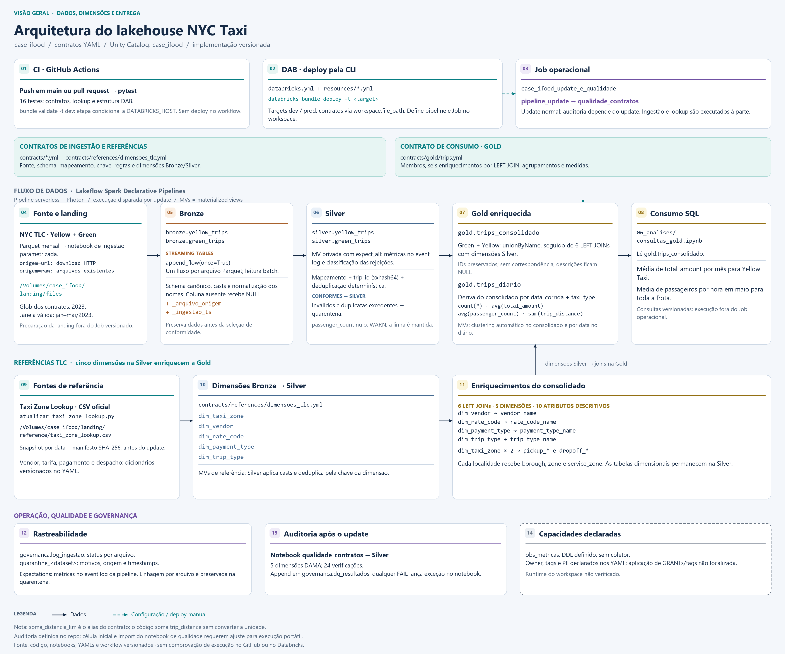
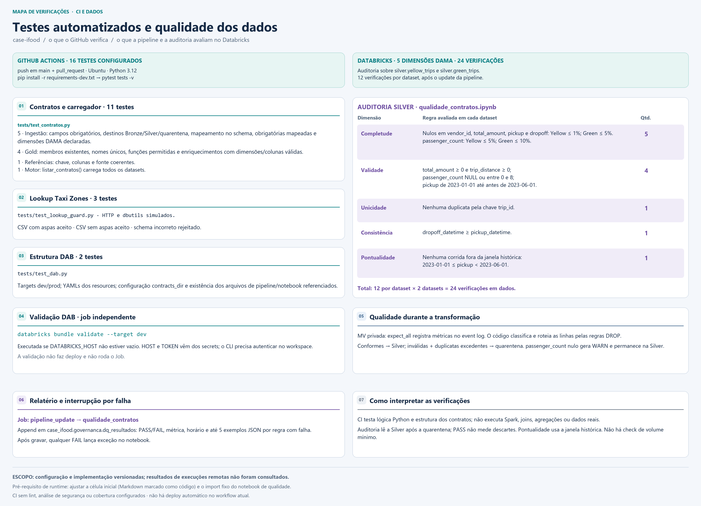

# Case iFood — Lakehouse NYC Taxi (medallion + DAMA-DMBOK)

Solução do case técnico iFood (Data Architect) na Databricks: ingestão orientada a **contratos de dados**, pipeline lakehouse medallion **bronze → silver → gold** no Unity Catalog, enriquecimento por dimensões TLC, auditoria de qualidade, CI no GitHub Actions e configuração de deploy via DAB.

## Diagrama da arquitetura implementada



[Imagem PNG em alta resolução](docs/arquitetura/arquitetura-projeto.png) · [SVG editável](docs/arquitetura/arquitetura-projeto.svg) · [Gerador do diagrama](docs/arquitetura/gerar_diagrama.py)

O diagrama foi reconstruído a partir do código, dos contratos, dos resources DAB e do workflow deste checkout. As setas distinguem dados e configuração/deploy manual. O bloco tracejado identifica capacidades apenas declaradas. As cinco dimensões são materializadas na **Bronze/Silver** e usadas em **seis LEFT JOINs na Gold**, pois Taxi Zones participa como embarque e desembarque. A execução remota no GitHub e no workspace Databricks não foi verificada.

## Testes automatizados e qualidade dos dados



[Imagem PNG em alta resolução](docs/arquitetura/testes-e-qualidade.png) · [SVG editável](docs/arquitetura/testes-e-qualidade.svg)

O workflow [`.github/workflows/tests.yml`](.github/workflows/tests.yml) executa `pytest tests -v` em **push para main e pull requests**, com Ubuntu e Python 3.12. Os **16 testes** são:

| Arquivo | Quantidade | O que verifica |
| --- | ---: | --- |
| [`tests/test_contratos.py`](tests/test_contratos.py) | 11 | Cinco testes de ingestão, quatro de Gold, um de dimensões TLC e um de carregamento dos contratos pelo motor. Validam campos, destinos, mapeamento, regras declaradas, membros, nomes, funções e referências de enriquecimento. |
| [`tests/test_lookup_guard.py`](tests/test_lookup_guard.py) | 3 | Aceita cabeçalho CSV com ou sem aspas e rejeita schema incorreto; HTTP e `dbutils` são simulados. |
| [`tests/test_dab.py`](tests/test_dab.py) | 2 | Targets dev/prod, resources YAML, configuração `contracts_dir` e existência dos arquivos de pipeline/notebook referenciados. |

O job independente `bundle-validate` executa `databricks bundle validate --target dev` se `DATABRICKS_HOST` não estiver vazio. HOST e TOKEN vêm dos secrets; a autenticação ainda precisa ser válida. **O workflow não executa deploy nem o Job Databricks**. Também não configura lint, cobertura ou análise de segurança. Os testes Python não executam Spark ou validam resultados dos joins/agregações em dados reais.

No Databricks, a pipeline usa `expect_all` para métricas no event log e lógica de classificação para separar Silver e quarentena. A auditoria posterior lê cada Silver e implementa **12 verificações por dataset, 24 no total**:

| Dimensão DAMA | Verificações por dataset | Regra |
| --- | ---: | --- |
| Completude | 5 | Nulos em `vendor_id`, `total_amount`, `pickup_datetime`, `dropoff_datetime`: Yellow ≤ 1%, Green ≤ 5%. Em `passenger_count`: Yellow ≤ 5%, Green ≤ 10%. |
| Validade | 4 | Valor e distância não negativos; passageiros nulos ou entre 0 e 8; pickup em `2023-01-01 ≤ pickup < 2023-06-01`. |
| Unicidade | 1 | Ausência de duplicatas pela chave `trip_id`. |
| Consistência | 1 | `dropoff_datetime >= pickup_datetime`. |
| Pontualidade | 1 | Ausência de corridas fora da janela histórica contratada. |

Os resultados são gravados em append em `case_ifood.governanca.dq_resultados`, com PASS/FAIL, métrica, horário e até cinco exemplos JSON por regra com falha. Após gravar, qualquer FAIL lança exceção no notebook de auditoria. Os limites de execução e a configuração inicial desse notebook estão descritos abaixo; a imagem representa a implementação, sem afirmar aprovação de uma execução remota.

### Evidências no repositório

| Etapa | Implementação e contrato que a orienta |
| --- | --- |
| Seleção e despacho da ingestão | [`01_ingestao/ingestao_parametrizada.ipynb`](01_ingestao/ingestao_parametrizada.ipynb), células 0 e 1: `carregar_contrato(f"{taxi_type}_trips")`, widgets `taxi_type`, `catalogo`, `ano`, `meses`, `origem`; despacho para `baixar_da_fonte()` ou `executar_ingestao()`. As células são numeradas a partir de zero. |
| Fonte HTTP → landing | [`00_config/motores.py`](00_config/motores.py), `baixar_da_fonte()`: `fonte.url_template` → download HTTP em partes, até 3 tentativas e arquivo temporário → `fonte.volume`. Arquivo existente e não vazio é pulado. O checksum MD5 cobre somente os primeiros 64 MiB. |
| Caminho `raw` | `executar_ingestao()` aceita volumes de origem e destino, mas o notebook não os fornece: ambos assumem `fonte.volume`. Portanto, a chamada padrão reconhece arquivos já presentes na landing e registra `ja_existia`; não estabelece uma segunda zona raw. O critério real de skip é destino existente com tamanho maior que zero. |
| Contratos dos datasets | [`contracts/green_trips.yml`](contracts/green_trips.yml) e [`contracts/yellow_trips.yml`](contracts/yellow_trips.yml): fonte, glob, schema canônico, nomes de destino, chave de deduplicação, mapeamento e regras. O pipeline tem seu próprio carregador `_carregar_contratos()`; o motor de ingestão e o notebook de qualidade usam os carregadores de `motores.py`. |
| Landing → bronze | [`02_pipelines/pipeline_case_ifood.py`](02_pipelines/pipeline_case_ifood.py): `dp.create_streaming_table()` + `_criar_fluxo_arquivo()` com `@dp.append_flow(once=True)`, um fluxo por arquivo encontrado pelo glob durante a construção do pipeline. A leitura de cada Parquet é batch via `spark.read`; aplica casts para `schema_bronze`, normalização de caixa, NULL para colunas ausentes e adiciona `_arquivo_origem` e `_ingestao_ts`. |
| Bronze → silver e quarentena | `_criar_silver_e_quarentena()` cria uma MV privada de validação e duas saídas públicas. Calcula `trip_id = xxhash64(...)` sobre a chave original, aplica `mapeamento_silver` e escolhe deterministicamente uma linha válida por `trip_id`. |
| Qualidade durante a transformação | `_expectations_do_contrato()` aplica `expect_all` na MV privada para manter as métricas de violações no event log; as mesmas regras classificam as linhas em `motivos_rejeicao`. Silver recebe só linhas válidas. Registros inválidos e duplicatas válidas excedentes vão para `case_ifood.governanca.quarantine_<dataset>`, com colunas originais prefixadas `_orig_`, campos mapeados, `_arquivo_origem`, `_ingestao_ts`, `taxi_type`, `trip_id` e `quarentena_ts`. `passenger_count` nulo é WARN e continua na Silver, não na quarentena. |
| Dimensões de referência | [`contracts/references/dimensoes_tlc.yml`](contracts/references/dimensoes_tlc.yml) declara os dicionários versionados (vendor, tarifa, pagamento e despacho) e a Taxi Zone Lookup oficial. `01_ingestao/atualizar_taxi_zone_lookup.py` baixa o CSV para `/Volumes/case_ifood/landing/reference/`; o pipeline publica dimensões Bronze e Silver. |
| Silver → gold | [`contracts/gold/trips.yml`](contracts/gold/trips.yml) → `_carregar_contratos_gold()` valida membros, dimensões e funções; `_criar_gold_consolidado()` lê green e yellow, aplica `unionByName(allowMissingColumns=True)` e executa os `LEFT JOINs` declarados. Gera `case_ifood.gold.trips_consolidado` com IDs originais mais nomes de vendor, tarifa, pagamento, despacho e zonas de embarque/desembarque. Sem correspondência, a linha permanece e a descrição fica nula. |
| Agregado diário | `_expressao_dimensao()`, `_expressao_medida()` e `_criar_gold_agregado()` geram `case_ifood.gold.trips_diario` a partir do consolidado: `to_date(pickup_datetime)` como `data_corrida`, `taxi_type`, `count(*)`, `avg(total_amount)`, `avg(passenger_count)` e `sum(trip_distance)`. Clustering por `data_corrida`. O alias `soma_distancia_km` é literal do contrato; não existe conversão de unidade no código. |
| Log operacional | Os dois motores de ingestão fazem append em `case_ifood.governanca.log_ingestao`: dataset, arquivo, fonte, tamanho, checksum, status, timestamp e mensagem. `criar_tabelas_governanca()` cria as tabelas Delta de governança. |
| Auditoria posterior de qualidade | [`03_qualidade/qualidade_contratos.ipynb`](03_qualidade/qualidade_contratos.ipynb), células 1 e 2: `listar_contratos()` → leitura das tabelas silver → completude, validade, unicidade, consistência e pontualidade. `_registrar()` e `_exemplos_violacoes()` produzem métricas PASS/FAIL e até 5 exemplos JSON para regras com falha, gravados em append em `case_ifood.governanca.dq_resultados`. Qualquer FAIL lança exceção depois da persistência. |
| CI e configuração de deploy | [`.github/workflows/tests.yml`](.github/workflows/tests.yml), [`databricks.yml`](databricks.yml) e [`resources/`](resources/): testes Python, validação condicional do bundle em dev, targets dev/prod, pipeline serverless com Photon e Job `pipeline_update → qualidade_contratos`. Deploy pela CLI, fora do workflow atual. |
| Consumo | [`06_analises/consultas_gold.ipynb`](06_analises/consultas_gold.ipynb): consultas SQL no consolidado enriquecido para média mensal do valor Yellow e média de passageiros por hora em maio na frota toda. |
| Observabilidade e segurança | `criar_tabelas_governanca()` contém o DDL de `case_ifood.governanca.obs_metricas`, mas nenhum escritor/coletor foi localizado. `owner`, `dominio`, `colunas_pii` e `tags` estão nos contratos; não foi localizada aplicação de GRANTs ou tags neste checkout. |

### Limites e diferenças em relação à documentação

- O Job versionado é `case_ifood_update_e_qualidade`: update da pipeline → auditoria de qualidade. Ingestão e atualização do lookup são executadas à parte. Os motores `04_observabilidade` e `05_seguranca` não estão versionados; `06_analises/consultas_gold.ipynb` está presente e não é task desse Job.
- Os glob dos contratos selecionam arquivos de **2023** e a validade do pickup está fixada em **2023-01-01 ≤ pickup < 2023-06-01**. Alterar `ano` ou `meses` no notebook de ingestão não modifica essas regras do pipeline. A dimensão de pontualidade testa essa janela histórica, não freshness operacional.
- A auditoria lê a **silver após a quarentena**; PASS não inclui a quantidade de rejeições, que deve ser consultada em `case_ifood.governanca.quarantine_<dataset>` ou nas métricas do event log. Não existe regra explícita de volume mínimo e o percentual de nulos é zero quando a tabela está vazia. Filtros SQL `NOT(expressão)` não contam resultados NULL como violações; completude é avaliada separadamente para as colunas configuradas.
- `_arquivo_origem` e `_ingestao_ts` não são selecionados pela silver e não chegam à gold; linhas rejeitadas os preservam na quarentena. Linhas conformes ainda não carregam essa linhagem até o consumo, e a execução não comprova a configuração de lineage nativa no workspace.
- No arquivo de qualidade versionado, a célula 0 contém texto Markdown, mas está marcada como `code`, sem `%md`. Esse conteúdo não é Python válido. A célula 1 também importa `motores` a partir de um caminho fixo em `/Workspace/Repos/`, que requer ajuste para um deploy portátil pelo bundle. A imagem representa a lógica das células 1 e 2; nenhum notebook foi alterado para produzir os diagramas.

Para reproduzir as duas imagens localmente, com **Pillow** e **PyYAML** instalados:

```powershell
python docs/arquitetura/gerar_diagrama.py
```

O gerador produz a arquitetura em **3600 × 3000** e o mapa de testes/qualidade em **3600 × 2600**, ambos em PNG, SVG com texto editável e prévia. Os arquivos finais incluem hashes SHA-256 das fontes em seus metadados. As contagens de testes e de verificações de auditoria são calculadas a partir dos arquivos; o gerador valida a composição representada antes de publicar as imagens. A renderização utiliza fontes locais (Segoe UI/Consolas no Windows, com fallback DejaVu no Linux).

## Estrutura

```text
case_ifood/
├── 00_config/            # Constantes compartilhadas e motores genéricos
│   └── motores.py        # Motor de ingestão genérico orientado a contrato
├── 01_ingestao/          # Notebook parametrizado de ingestão (wrapper do motor)
├── 02_pipelines/         # Pipeline SDP medallion (lê os contratos)
│   └── pipeline_case_ifood.py
├── 03_qualidade/         # Motor de qualidade (dimensões DAMA-DMBOK)
├── 06_analises/          # Consultas SQL de consumo na Gold
├── contracts/            # Contratos de dados (YAML) — fonte única da verdade
│   ├── references/      # Cinco dimensões TLC (CSV e dicionários)
│   └── gold/            # Unificação, enriquecimentos e agregado diário
├── .github/workflows/   # CI: pytest e validação condicional do bundle
├── resources/           # Pipeline e Job declarados via DAB
├── tests/               # 16 testes Python sem Spark
├── docs/arquitetura/    # PNGs, SVGs e gerador dos dois diagramas
├── databricks.yml       # Bundle e targets dev/prod
├── SDD.md                # Guia de contratos para IA — LEITURA OBRIGATÓRIA
└── README.md
```

## Unity Catalog

| Objeto | Papel |
| --- | --- |
| `case_ifood.landing.files` (volume) | Landing zone — arquivos parquet raw |
| `case_ifood.bronze` | Dados brutos como chegaram + metadados de ingestão |
| `case_ifood.silver` | Dados limpos, tipados, deduplicados, colunas obrigatórias |
| `case_ifood.gold` | Camada de consumo (SQL/BI) |
| `case_ifood.governanca` | Qualidade (`dq_resultados`), observabilidade (`obs_metricas`), log de ingestão (`log_ingestao`) e quarentena (`quarantine_yellow_trips`, `quarantine_green_trips`) |

## Modelo de dados (medallion)

- **bronze.yellow_trips / bronze.green_trips** — streaming tables alimentadas pelo volume landing, com metadados `_arquivo_origem` e `_ingestao_ts`.
- **silver.yellow_trips / silver.green_trips** — apenas registros válidos pelas regras DROP do contrato, deduplicados pela chave e mapeados para nomes padronizados. `passenger_count` nulo é aviso e permanece.
- **governanca.quarantine_yellow_trips / quarantine_green_trips** — linhas que falham regras DROP e duplicatas removidas da Silver, com motivo(s), colunas da Bronze prefixadas `_orig_`, arquivo de origem, timestamp de ingestão e timestamp de quarentena. Reprocessamento deve partir da Bronze após a correção da regra ou do dado.
- **bronze/silver.dim_taxi_zone, dim_vendor, dim_rate_code, dim_payment_type, dim_trip_type** — dimensões de referência; a Silver aplica casts e deduplicação pela chave.
- **gold.trips_consolidado** — união green + yellow com `taxi_type`, enriquecida por seis LEFT JOINs com as dimensões Silver; **gold.trips_diario** — agregado por data e tipo de táxi, derivado do consolidado.

## Dicionário de colunas (camada de consumo)

| Coluna | Descrição |
| --- | --- |
| `vendor_id` | ID do fornecedor de tecnologia do taxímetro |
| `passenger_count` | Nº de passageiros informado pelo motorista |
| `total_amount` | Valor total cobrado (tarifa + taxas + gorjeta + pedágio) |
| `pickup_datetime` / `dropoff_datetime` | Início e fim da corrida |
| `taxi_type` | yellow ou green |
| `trip_id` | Chave de dedupe (hash determinística da corrida) |
| `vendor_name`, `rate_code_name`, `payment_type_name`, `trip_type_name` | Descrições obtidas dos dicionários TLC |
| `pickup_borough`, `pickup_zone`, `pickup_service_zone` | Localidade de embarque obtida de Taxi Zones |
| `dropoff_borough`, `dropoff_zone`, `dropoff_service_zone` | Localidade de desembarque obtida de Taxi Zones |

## Contratos de dados

Cada dataset tem um YAML em `contracts/` (fonte, destino, grain, chave de dedupe, schema esperado, regras de qualidade por dimensão DAMA, owner e PII). Ele orienta ingestão, SDP e auditoria de qualidade; os campos de governança também documentam capacidades ainda não implementadas. Dimensões ficam em `contracts/references/`; consumo em `contracts/gold/`: membros a unificar, enriquecimentos e agregados derivados.

> 📖 **Leitura obrigatória (IA e onboarding):** `SDD.md` — dicionário campo a campo dos contratos de ingestão e de gold, árvore de decisão para novas visões, protocolo de interação e fluxo de execução (YAML → dry run → update → verificação). Nenhuma visão/dataset novo se resolve editando o código do pipeline.

### Runbook: onboarding de um novo dataset

1. Copie um contrato em `contracts/` e ajuste fonte, destino, schema e regras.
2. Coloque os parquets no volume landing (o motor de ingestão aceita qualquer parquet em volume raw).
3. Rode o notebook `01_ingestao` com `taxi_type=<novo>`.
4. Rode um update da pipeline SDP — as tabelas são geradas a partir dos contratos.
5. Nenhuma linha de código específica de dataset precisa ser escrita.

## CI/CD e orquestração

O CI está definido em [`.github/workflows/tests.yml`](.github/workflows/tests.yml). O deploy é manual pela CLI, usando os targets de [`databricks.yml`](databricks.yml):

```powershell
databricks bundle deploy -t dev
# Para o target de produção:
databricks bundle deploy -t prod
```

O resource [`resources/case_ifood_medallion.pipeline.yml`](resources/case_ifood_medallion.pipeline.yml) declara a pipeline serverless, com Photon, e resolve os contratos por `${workspace.file_path}/contracts`. O target dev usa `development: true`; prod usa `development: false`.

O Lakeflow Job [`case_ifood_update_e_qualidade`](resources/case_ifood_update_e_qualidade.job.yml) executa **pipeline_update → qualidade_contratos**, com dependência explícita entre as tasks. A task de pipeline não solicita full refresh; o notebook recebe `catalogo=case_ifood` e `datasets` vazio (todos os contratos). Ingestão, atualização do lookup e consultas de consumo são executadas à parte. A configuração está versionada; sua execução no workspace não foi validada nesta atualização de documentação.

## Análises (entregáveis do case)

O notebook [`06_analises/consultas_gold.ipynb`](06_analises/consultas_gold.ipynb) contém duas consultas no consolidado enriquecido:

- Média de `total_amount` por mês para Yellow Taxi.
- Média de `passenger_count` por hora do dia em maio para todos os táxis.
